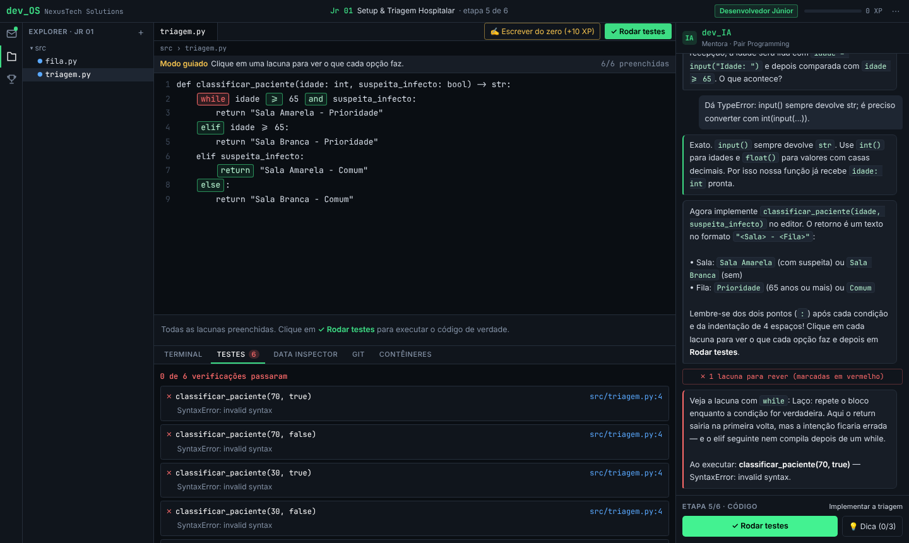
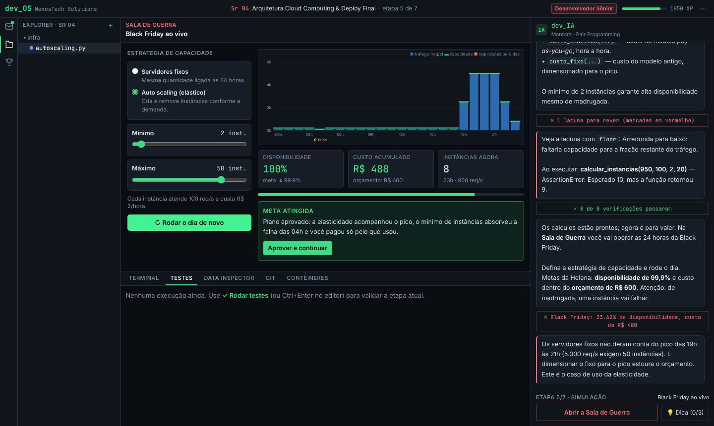

# dev_OS — Simulador Interativo de Carreira em Engenharia de Software

Serious game em que a própria **IDE é o tabuleiro**: você é um(a) dev recém-contratado(a) na
NexusTech Solutions e evolui de **Júnior a Sênior** resolvendo demandas que chegam por e-mail,
com a mentora **dev_IA** fazendo pair programming a cada decisão.

Documento de design: [`docs/GDD-SAD-dev_OS.pdf`](docs/GDD-SAD-dev_OS.pdf)





## Como rodar

Requer Node.js 20+.

```bash
npm install
```

```bash
npm run dev
```

Abra http://localhost:3000. O progresso fica salvo no `localStorage` do navegador.

| Comando | O que faz |
| --- | --- |
| `npm run dev` | servidor de desenvolvimento |
| `npm run build` / `npm start` | build e servidor de produção |
| `npm test` | joga as 15 missões com as soluções de referência e com o gabarito das lacunas (Vitest + Pyodide + SQL.js) |
| `npm run typecheck` | checagem de tipos |

O `postinstall` copia Pyodide, SQL.js e Monaco para `public/` — o jogo não depende de CDN.

## O que está implementado

O Workspace de uma tela só, com os cinco módulos do GDD:

- **MailClient** — caixa de entrada com as demandas, e-mails de promoção e estrelas por missão.
- **Code Editor & File Tree** — Monaco (o editor do VS Code), abas, criação de arquivos, marcação da linha do erro e **lente de sintaxe** (passe o mouse sobre uma palavra-chave para ver o que ela faz).
- **Integrated Terminal** — xterm.js com um shell simulado: `python` **executa de verdade** (Pyodide/WebAssembly, em Web Worker com limite de tempo); `pip`, `git`, `npm`, `docker`, `kubectl` e `mongosh` são simulações com estado.
- **Data Inspector** — tabelas SQL (SQLite em WebAssembly), consultas avulsas e coleções MongoDB (simulador em memória com `$jsonSchema`).
- **Copiloto dev_IA** — Action Cards de decisão com explicação dos trade-offs, dicas progressivas e feedback dos testes.

A campanha completa: **15 missões** nos três atos (Jr 01–05, Pl 01–06, Sr 01–04), com XP,
promoções e um Boss Challenge por nível.

### Mecânicas de jogo

- **Código com lacunas (modo guiado)** — toda etapa de código mostra a estrutura pronta com lacunas clicáveis. Cada opção explica o que aquela sintaxe faz, inclusive as erradas. Ao verificar, o código montado é **executado de verdade**: uma escolha errada mostra o erro real (o `SyntaxError`, o laço infinito, a constraint violada).
- **Escrever do zero** — em qualquer etapa dá para dispensar as lacunas e usar o editor livre, valendo XP de bônus.
- **Code review invertido** — o jogador revisa o código de um colega e marca as linhas com problema (Jr 02, Pl 04, Sr 03).
- **Sala de Guerra** — simuladores de arquitetura: teste de carga no API Gateway com queda de instância (Sr 01) e as 24 horas da Black Friday com orçamento e auto scaling (Sr 04).
- **Painel Git** — working directory → staging → repositório local → remoto, com o grafo de commits atualizado a cada comando.
- **Painel Contêineres** — camadas da imagem Docker (tamanho, tempo de build e cache) recalculadas enquanto o `Dockerfile` é editado, e os pods do cluster, que podem ser derrubados para ver o Kubernetes recriá-los.
- **Carreira** — mapa da trilha, estrelas por missão e 12 conquistas.
- Eventos de mentoria do GDD: push bloqueado por `.env` no commit, `UPDATE`/`DELETE` sem `WHERE` congelado, `ModuleNotFoundError` antes do `pip install`.

### Como cada etapa é validada

| Tipo de etapa | Validação |
| --- | --- |
| `DECISAO_ARQUITETURAL` | múltipla escolha com feedback por opção |
| `IMPLEMENTACAO_CODIGO` | testes Python reais no Pyodide (casos de teste e asserts) |
| `IMPLEMENTACAO_SQL` | script executado no SQLite; confere resultado e constraints |
| `IMPLEMENTACAO_MONGO` | script executado no simulador; confere documentos e o validador |
| `VALIDACAO_ESTATICA` | regras estruturais sobre o arquivo (Java, TypeScript, Dockerfile, YAML) |
| `COMANDO_TERMINAL` | comandos precisam rodar com sucesso no shell |
| `REVISAO_CODIGO` | conjunto exato de linhas problemáticas marcadas |
| `SIMULACAO` | metas do simulador atingidas (disponibilidade, custo) |

As quatro etapas de código aceitam `lacunas` (ver `src/game/quests/lacunas.ts`): no modo guiado,
o arquivo é montado a partir das escolhas e passa pela mesma validação do modo livre.

### Diferenças em relação ao GDD (ainda não implementado)

- **Sem back-end.** Tudo roda no navegador; não há FastAPI/Spring, PostgreSQL, MongoDB Atlas, login ou JWT. O progresso é local.
- **Java, TypeScript, Dockerfile e YAML não são compilados nem executados**: a validação é por regras estruturais (regex), não por AST nem contêineres efêmeros.
- **A dev_IA é baseada em regras** (conteúdo das missões). Não há integração com LLM.
- **Os simuladores são modelos didáticos**, com números fixos e determinísticos (tráfego, custos, tamanho das camadas Docker); não medem infraestrutura real.
- **Git sem branches**: o simulador cobre init/add/commit/push; branch, merge e pull request ainda não existem.
- **Sem conteinerização/deploy** da aplicação (Fase 4 do roadmap).
- SQL usa SQLite: tipos Oracle (`VARCHAR2`, `NUMBER`) são aceitos, mas `SEQUENCE` e `ALTER TABLE ... ADD CONSTRAINT` não — esses conceitos entram como cartões de decisão.

## Arquitetura

```
src/
  app/                  Next.js (App Router) — página única, renderizada no cliente
  components/           Workspace, Mail, Explorer, EditorPane, TerminalPane, DataInspector, MentorPanel…
  game/
    types.ts            contrato de dados da missão (GDD §5)
    quests/             catálogo: junior.ts, pleno.ts, senior.ts + lacunas.ts (modo guiado)
    sim/                simuladores puros: balanceador, Black Friday, camadas Docker
    glossario.ts        explicações da lente de sintaxe
    conquistas.ts       conquistas derivadas do progresso
    state/store.ts      motor de estado (Zustand + persistência): etapas, XP, promoções, chat
    validators/         validador de cada tipo de etapa
    runtime/            Pyodide (harness + worker), SQL.js, simulador MongoDB
    shell/              shell do terminal e índice de pacotes simulados
public/workers/         Web Worker do Pyodide
tests/                  soluções de referência + testes de jogabilidade
```

O motor (`game/`) não depende de React: os mesmos validadores rodam no navegador e nos testes em Node.

## Criando uma nova missão

Uma missão é um objeto serializável que segue `Quest` em `src/game/types.ts`. Adicione-o ao
arquivo do nível em `src/game/quests/`, com `ordemTrilha` sequencial, e inclua a solução de
referência em `tests/solucoes.ts` — `npm test` garante que o código inicial falha e que a
solução passa em todas as etapas. Para o modo guiado, registre as lacunas da etapa em
`src/game/quests/lacunas.ts` (o teste confere que o gabarito das lacunas também passa).
